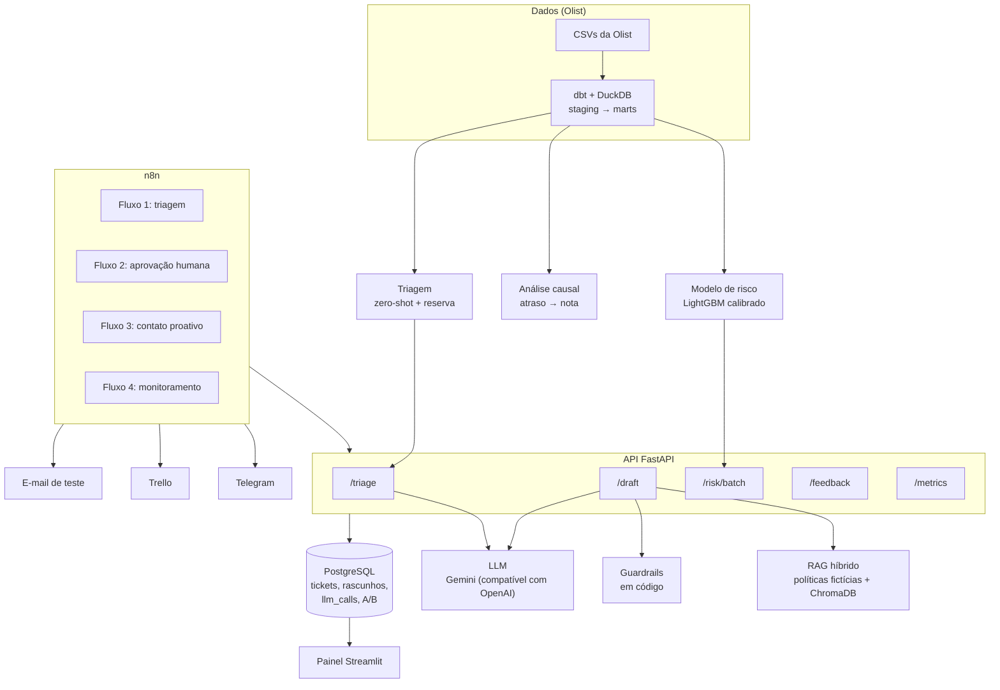

# Copiloto de Atendimento

Projeto de portfólio que simula o trabalho de um time de **ciência de dados e engenharia de IA** numa loja online brasileira, sobre a base pública da Olist.
- **Ciência de dados:** prever avaliações negativas antes que aconteçam, medir quanto o atraso de entrega custa e desenhar o teste que mede o efeito do contato proativo.
- **Engenharia de IA:** triar reclamações e escrever rascunhos de resposta com RAG, guardrails e aprovação humana.
- **Automação:** o n8n orquestra tudo, com Telegram, Trello e e-mail.

> Todo número abaixo vem de um script versionado, e os relatórios gerados dizem qual. As políticas da loja são **fictícias**. As premissas de custo estão em [`docs/relatorio-impacto.md`](docs/relatorio-impacto.md).

## Resultados

| Pergunta | Resultado | Detalhes |
| --- | --- | --- |
| Dá para prever a nota negativa no dia da entrega? | PR-AUC de **0,343** no teste temporal, contra 0,156 da regra "atrasou" (+0,187, IC 95% de +0,167 a +0,208) | [Model card do risco](docs/model-cards/risco.md) |
| Vale contatar quem o modelo aponta? | Com o limiar por custo (0,41), **R$ 876** de valor líquido no período de teste, contra R$ 18 da regra simples. Depende da premissa do efeito do contato | [Relatório de impacto](docs/relatorio-impacto.md) |
| Quanto o atraso causa de nota negativa? | **+45,3 p.p.** (IPW, IC 95% de 44,1 a 46,3): 453 negativas a mais a cada 1.000 atrasos | [Análise causal](docs/analise-causal.md) |
| Quanto tempo leva o teste A/B do contato? | 237 pedidos por grupo, cerca de **57 dias**, para detectar uma queda de 20% | [Experimento](docs/experimento-ab.md) |
| LLM ou modelo local na triagem? | Zero-shot com **83,5%** de acurácia (F1 macro 0,738), contra 71,5% do embeddings. **75%** dos tickets são automáticos, com 92% de acerto, a R$ 1,64 por 1.000 | [Model card da triagem](docs/model-cards/triagem.md) |
| O copiloto cita a política certa? | **98,3%** de citação e 98,3% de ação aceita em 60 casos (eram 81,7% e 88,3% antes da busca híbrida) | [Model card do copiloto](docs/model-cards/copiloto.md) |
| Dá para usar um LLM como juiz? | **Não, aqui:** kappa de 0,15 contra a avaliação de referência, abaixo da regra de 0,40 | [ADR 0011](docs/decisoes/0011-avaliacao-do-copiloto.md) |

**Transparência:** o conjunto ouro da triagem e a avaliação dos rascunhos foram feitos com apoio de outra IA ([ADR 0013](docs/decisoes/0013-rotulos-e-avaliacao-assistidos-por-ia.md)). Esta e as demais limitações estão em [`docs/limitacoes.md`](docs/limitacoes.md).

## Arquitetura



A mesma imagem, em PNG: [`docs/arquitetura.png`](docs/arquitetura.png).

| Camada | Pasta | Responsabilidade |
| --- | --- | --- |
| Dados | `dbt/` | Staging, intermediate e marts no DuckDB, com testes de qualidade e features "as-of" |
| Ciência de dados | `src/copiloto/ds/` | Modelo de risco, análise causal e experimento |
| IA | `src/copiloto/ai/` | Taxonomia, rotulagem, triagem, RAG, guardrails e avaliação |
| Serviços e API | `src/copiloto/services/`, `src/copiloto/api/` | Casos de uso e FastAPI (`/triage`, `/draft`, `/feedback`, `/risk/batch`, `/metrics`) |
| Persistência | `src/copiloto/db/`, `migrations/` | PostgreSQL e Alembic |
| Automação | `n8n/` | 4 fluxos exportados, sem credenciais |
| Painel | `src/copiloto/dashboard/` | Métricas da operação e da qualidade |

O n8n **só orquestra**. Toda regra de negócio fica em Python, testada ([ADR 0012](docs/decisoes/0012-fluxos-n8n.md)).

## Decisões

O [design doc](docs/design-doc.md) resume o problema, as alternativas e os riscos. Cada decisão tem um ADR em [`docs/decisoes/`](docs/decisoes/):
- **Dados:** DuckDB + dbt (0003).
- **Risco e causal:** limiar por custo (0005); IPW e pareamento à mão (0006).
- **Triagem:** taxonomia (0007); protocolo da comparação e escolha da produção (0009).
- **Copiloto:** guardrails em código (0010); avaliação e juiz (0011).
- **Automação:** fluxos do n8n (0012).
- **Transparência:** rótulos com apoio de IA (0013).

## Como rodar

**Pré-requisitos:**
- Python 3.11 e Docker Desktop.
- A base [Brazilian E-Commerce Public Dataset by Olist](https://www.kaggle.com/datasets/olistbr/brazilian-ecommerce), sob a licença **CC BY-NC-SA 4.0**. Os 9 CSVs vão em `data/raw/` e **não** estão neste repositório.
- Uma chave de um LLM compatível com OpenAI (o projeto usa `gemini-3.5-flash-lite`, no plano gratuito).

**1. Ambiente (Windows, PowerShell)**

```powershell
py -3.11 -m venv .venv
.\.venv\Scripts\Activate.ps1
pip install -r requirements-dev.txt
pip install -e .
Copy-Item .env.example .env   # preencha os valores (o .env nunca vai para o git)
```

**2. Dados e modelos (sem LLM)**

```powershell
python scripts/dbt_build.py            # DuckDB + testes de qualidade
python scripts/train_risk.py           # modelo de risco, model card e gráficos
python scripts/causal_analysis.py      # efeito causal do atraso
python scripts/ab_design.py            # tamanho de amostra e simulação do A/B
python scripts/train_triage_embeddings.py
python scripts/index_policies.py       # políticas no ChromaDB
python scripts/impact_report.py        # relatório de impacto em reais
```

**3. Avaliações com LLM** (cada script mostra a estimativa de chamadas e custo e só chama o LLM com `--allow-llm`)

```powershell
python scripts/evaluate_triage.py --split val --approaches zero_shot,embeddings_lr --estimate
python scripts/evaluate_copilot.py --stage drafts --estimate
```

**4. Tudo no ar: API, banco, n8n e painel**

```powershell
docker compose up -d --build
```

- API: `http://localhost:8000/docs`
- n8n: `http://localhost:5678` (configuração em [`n8n/README.md`](n8n/README.md))
- Painel: `http://localhost:8501`

**5. Simular reclamações chegando**

```powershell
python scripts/simulate_tickets.py --n 2 --interval 30
```

## Qualidade

```powershell
ruff check .
ruff format --check .
pytest
```

O CI (GitHub Actions) roda lint, formatação e mais de 240 testes a cada push:
- dbt sobre uma amostra fictícia;
- contrato da API;
- casos de regressão do copiloto;
- ausência de segredos nos fluxos do n8n.

**Os testes nunca chamam o LLM real.**

## Documentação

| Documento | Conteúdo |
| --- | --- |
| [`docs/design-doc.md`](docs/design-doc.md) | Problema, métricas, alternativas, decisões e riscos |
| [`docs/relatorio-impacto.md`](docs/relatorio-impacto.md) | Valores em reais e premissas (gerado por script) |
| [`docs/model-cards/`](docs/model-cards/) | Risco, triagem e copiloto |
| [`docs/analise-causal.md`](docs/analise-causal.md), [`docs/experimento-ab.md`](docs/experimento-ab.md) | Causal e A/B |
| [`docs/limitacoes.md`](docs/limitacoes.md), [`docs/seguranca.md`](docs/seguranca.md) | Limitações e segurança |
| [`docs/roteiro-video.md`](docs/roteiro-video.md) | Roteiro do vídeo e rascunho do post |
| [`docs/aprendizado.md`](docs/aprendizado.md) | O porquê de cada decisão, em linguagem simples |
| [`docs/progresso.md`](docs/progresso.md) | Diário das fases |

## Licença

Código sob licença MIT. Os dados da Olist seguem a licença deles (CC BY-NC-SA 4.0) e não são redistribuídos. Políticas, casos de avaliação e nomes da "Loja Exemplo" são fictícios.
