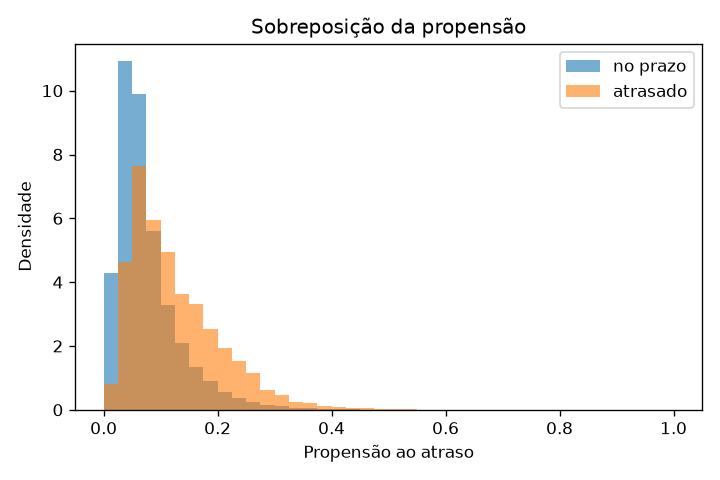
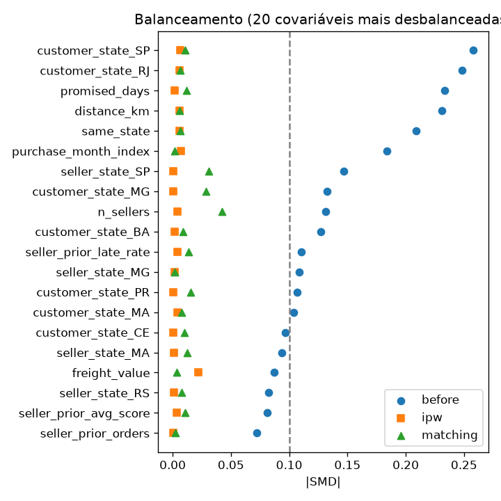

# Análise causal: resultados

Gerado por `scripts/causal_analysis.py`. Não edite à mão: rode o script de novo.

## Dados

- Pedidos entregues e avaliados: 95.824
- Atrasados: 7.661 (8.0%)
- Taxa negativa: atrasados 54.1%, no prazo 9.2%
- Covariáveis na propensão (após one-hot): 99

## Efeito do atraso na chance de nota negativa

| Estimador | Efeito | IC 95% (bootstrap) |
| --- | ---: | --- |
| Diferença ingênua | +44.8 p.p. | +43.7 p.p. a +45.8 p.p. |
| IPW (ATT) | +45.3 p.p. | +44.1 p.p. a +46.3 p.p. |
| Pareamento (ATT) | +45.2 p.p. | +43.8 p.p. a +46.5 p.p. |
| IPW (ATE) | +45.7 p.p. | +44.3 p.p. a +47.1 p.p. |

Bootstrap com 200 reamostras, reajustando a propensão em cada uma.

Sem atraso, os pedidos atrasados teriam taxa negativa estimada de 8.8% (IPW), contra 54.1% observada.

## Efeito na nota média (1 a 5)

| Estimador | Efeito |
| --- | ---: |
| Ingênuo | -1.73 |
| IPW (ATT) | -1.75 |
| Pareamento | -1.74 |

## Sobreposição

- Propensão média: atrasados 0.125, no prazo 0.076
- Faixa comum: 0.010 a 0.759; fora dela: 0.0% dos pedidos
- Pedidos no limite de corte da propensão (0,01 ou 0,99): 2.2%
- Pareamento: 7.660 atrasados pareados, 1 descartados pelo caliper, 6.860 controles distintos usados

## Balanceamento (|SMD| < 0,1 é bom)

| Método | Maior \|SMD\| | Covariáveis acima de 0,1 |
| --- | ---: | ---: |
| Antes | 0.258 | 14 de 99 |
| IPW | 0.022 | 0 de 99 |
| Pareamento | 0.042 | 0 de 99 |

## Sensibilidade a confundidor não observado

- Razão de risco (IPW): 6.16 (limite inferior do IC: 5.42)
- E-value: 11.80 (para o limite do IC: 10.31)

## Tradução em negócio

- Cada 1.000 pedidos atrasados geram **453** avaliações negativas a mais (IC 95%: 441 a 463).
- Com a premissa de R$ 30 por avaliação negativa: R$ 13.584 a cada 1.000 pedidos atrasados.
- Na base inteira: 7.661 atrasados, cerca de 3.469 negativas causadas pelo atraso.
