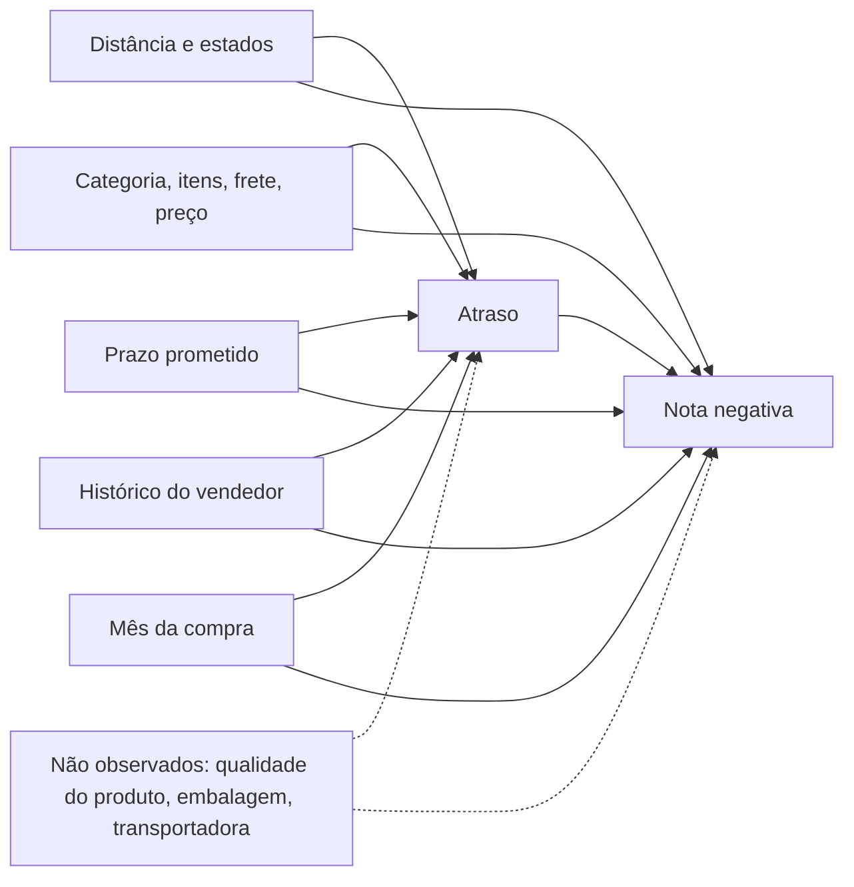

# Análise causal: quanto o atraso de entrega custa

> **Conclusão em uma frase:** atrasar a entrega aumenta em cerca de **45 pontos percentuais** a chance de o pedido receber nota 1 ou 2 (de 8,8% para 54,1% nos pedidos que atrasaram), o que significa **453 avaliações negativas a mais a cada 1.000 pedidos atrasados** (IC 95%: 441 a 463).

Números gerados por `scripts/causal_analysis.py`. Tabelas completas em [`analise-causal-resultados.md`](analise-causal-resultados.md) e números brutos em `eval/results/causal.json`.

## Pergunta

Qual é o efeito médio do atraso na nota dos pedidos que atrasaram (ATT)? A comparação simples (54,1% de negativas entre atrasados contra 9,2% entre entregues no prazo) pode estar contaminada: pedidos atrasados tendem a vir de mais longe, de certas categorias e de vendedores com histórico pior, fatores que poderiam piorar a nota mesmo sem atraso.

## Premissas (DAG)

**Premissas principais:**
1. Todos os confundidores relevantes estão entre os observados. Os não observados (linha tracejada) são tratados na análise de sensibilidade.
2. Não controlamos por variáveis posteriores ao atraso, como dias até a entrega, porque isso bloquearia parte do próprio efeito.
3. Um pedido não afeta a nota de outro.

## Método

1. **Propensão:** regressão logística da probabilidade de atraso dados 99 covariáveis. Elas incluem distância, prazo prometido, estados, categoria, itens, preço, frete, pagamento, histórico do vendedor e mês da compra (one-hot para categorias).
2. **Sobreposição e balanceamento:** verificados antes de estimar.
3. **Estimadores:** IPW (ATT e ATE) e pareamento 1:1 pelo logit da propensão, com caliper de 0,2 desvio-padrão, implementados à mão (ADR 0006).
4. **Incerteza:** bootstrap com 200 reamostras, reajustando a propensão em cada uma.
5. **Sensibilidade:** E-value para um confundidor não observado.

## Resultados

| Estimador | Efeito na chance de nota negativa | IC 95% |
| --- | ---: | --- |
| Diferença ingênua | +44,8 p.p. | +43,7 a +45,8 |
| **IPW (ATT)** | **+45,3 p.p.** | **+44,1 a +46,3** |
| Pareamento (ATT) | +45,2 p.p. | +43,8 a +46,5 |
| IPW (ATE) | +45,7 p.p. | +44,3 a +47,1 |

- Na nota média (1 a 5), o atraso tira cerca de **1,75 ponto** (IPW −1,75; pareamento −1,74; ingênuo −1,73).
- **Sobreposição:** nenhum pedido ficou fora da faixa comum de propensão. Só 1 dos 7.660 atrasados foi descartado pelo caliper.
- **Balanceamento:** antes do ajuste, 14 das 99 covariáveis tinham |SMD| > 0,1, com o maior em 0,258. Depois do IPW, nenhuma: o maior ficou em 0,022. Depois do pareamento, o maior ficou em 0,042.

### Por que o ajuste quase não mudou o número?

Esperávamos que a diferença ingênua exagerasse o efeito. Não exagerou: o ajuste até aumentou levemente a estimativa (+44,8 → +45,3 p.p.). Sem atraso, os pedidos que atrasaram teriam 8,8% de negativas, um pouco **menos** que os 9,2% dos entregues no prazo. Ou seja, os confundidores observados explicam muito pouco da diferença, e o perfil dos atrasados não era pior do que o dos outros. O efeito é grande e direto: atraso gera nota ruim.

Isso é um resultado, não uma falha do método. Os testes com dados sintéticos (`tests/unit/test_causal.py`) mostram que o mesmo código corrige o viés quando ele existe.

## Sensibilidade a confundidor não observado

- Razão de risco (IPW): **6,16**. Atrasados têm cerca de 6 vezes a chance de nota negativa que teriam sem atraso.
- **E-value: 11,8** (para o limite do IC: 10,3). Para anular o efeito, um confundidor não observado precisaria multiplicar por mais de 10 tanto a chance de atraso quanto a chance de nota negativa, além de tudo o que já foi controlado. Isso é muito improvável.

**Em linguagem simples:** pode existir algo que não medimos, como uma transportadora ruim que atrasa e também entrega caixas amassadas. Mas esse fator teria de ser absurdamente forte para explicar o resultado inteiro. O mais provável é que parte dos 45 p.p. venha desses fatores e a maior parte venha do atraso.

## Tradução em negócio

- Cada **1.000 pedidos atrasados geram 453 avaliações negativas a mais** (IC 95%: 441 a 463).
- Com a premissa de R$ 30 por avaliação negativa, são cerca de **R$ 13,6 mil a cada 1.000 atrasos**, ou R$ 13,60 por pedido atrasado.
- Na base histórica, 7.661 atrasos causaram cerca de **3.469 avaliações negativas**.

**Implicações:**
1. Reduzir atraso, por exemplo com prazos prometidos mais realistas ou trocando a transportadora, é a alavanca mais forte de satisfação.
2. Como até R$ 13,60 por atraso está em jogo, faz sentido gastar com contato proativo nos atrasados de maior risco, desde que o contato funcione. Isso é o que o teste A/B mede ([`experimento-ab.md`](experimento-ab.md)).

## Limitações

1. **Tratamento binário:** atraso de 1 dia e de 20 dias contam igual. A Fase 1 mostrou que o risco cresce com os dias de atraso (19% com 1 a 3 dias contra 79% com mais de 10). O efeito de 45 p.p. é uma média.
2. **Confundidores não observados:** qualidade do produto, embalagem e transportadora não estão na base. O E-value indica robustez, mas não prova causalidade.
3. **Mensuração do resultado:** 4.967 avaliações foram feitas antes da entrega, muitas provavelmente de clientes reclamando que o pedido não chegou. Isso faz parte do efeito do atraso, não é um erro.
4. **Valor da avaliação negativa (R$ 30) é premissa**, assim como no modelo de risco.
5. **Período e loja:** Olist, 2016 a 2018. O número não se transfere direto para outra loja.
