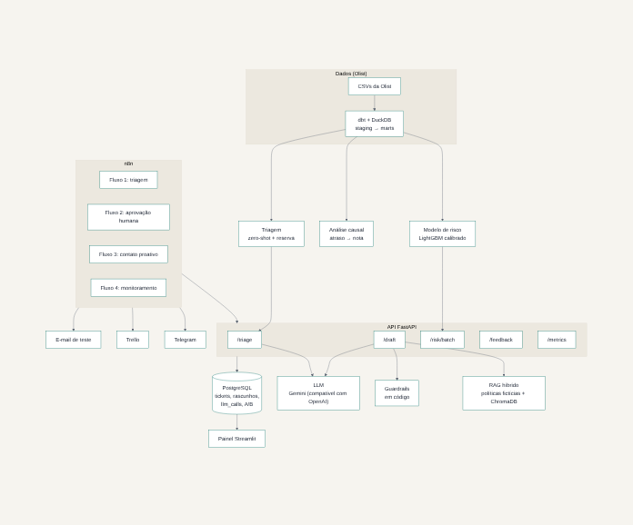

# Design doc: Copiloto de Atendimento

- **Autor:** Eduardo
- **Status:** implementado (portfólio)
- **Data:** novembro de 2026

Os números deste documento vêm dos relatórios gerados por script:
- `docs/model-cards/*`
- `docs/analise-causal-resultados.md`
- `docs/experimento-ab-resultados.md`
- `docs/relatorio-impacto.md`

## 1. Problema

Uma loja online brasileira (cenário sobre a base pública da Olist) tem dois problemas ligados.

1. **Avaliações negativas.** Pedidos atrasados viram notas 1 ou 2, e a loja só descobre depois da avaliação.
2. **Atendimento manual.** Cada reclamação é lida, classificada e respondida por uma pessoa, sem padrão e sem consultar as políticas.

**Perguntas de negócio:**
- quanto o atraso custa;
- dá para agir antes da avaliação;
- dá para acelerar o atendimento sem a IA prometer o que a loja não cumpre.

## 2. Objetivos e métricas

| Objetivo | Métrica principal | Por quê |
| --- | --- | --- |
| Prever nota negativa no dia da entrega | PR-AUC no teste temporal | Alvo desbalanceado (12,81% de negativas) |
| Decidir quem contatar | Valor líquido em reais, com premissas | O limiar depende de custo, não de 0,5 |
| Medir o custo do atraso | Efeito causal (ATT) com IC 95% | Correlação exagera ou esconde o efeito |
| Triagem automática | F1 macro, acurácia, cobertura com 85% de acerto, custo e latência | Qualidade sozinha não decide |
| Rascunhos seguros | Citação da política certa, ação aceita, eventos de guardrail | Medidas exatas, sem depender de juiz |

**Fora do escopo:** responder sozinho ao cliente (sempre há aprovação humana), dados pessoais reais e deploy em nuvem.

## 3. Arquitetura

**Camadas e responsabilidades:**
- **dbt + DuckDB:** dados e testes de qualidade.
- **`src/copiloto/ds`:** risco, causal e experimento.
- **`src/copiloto/ai`:** triagem, RAG, guardrails e avaliação.
- **`services` + `api`:** casos de uso e FastAPI.
- **`db`:** PostgreSQL com migrações.
- **n8n:** só orquestra (ADR 0012).
- **Painel Streamlit:** métricas.

**Princípio:** toda regra de negócio fica em Python, testada e versionada. O n8n liga os sistemas.

## 4. Alternativas e decisões

| Tema | Alternativas | Decisão | ADR |
| --- | --- | --- | --- |
| Camada de dados | pandas solto; Spark | dbt + DuckDB | 0003 |
| Limiar do risco | 0,5; top-N | Maximizar o valor esperado na validação | 0005 |
| Causal | Biblioteca pronta | IPW e pareamento implementados à mão | 0006 |
| Triagem | Zero-shot; embeddings + LR; BERTimbau | Zero-shot com reserva por embeddings (BERTimbau fora) | 0009 |
| Fronteira atraso × não recebido | Só pelo texto | Junta na métrica e separa pelo status do pedido | 0007 |
| Copiloto | Só busca vetorial | Busca híbrida, com a política da categoria sempre incluída | 0011 |
| Segurança | Pedir ao LLM que se comporte | Guardrails determinísticos em código | 0010 |
| Avaliação | Só juiz LLM | Verificações automáticas; juiz só se validado (não foi) | 0011, 0013 |
| Orquestração | Código próprio | n8n sem regra de negócio, credenciais fora do git | 0012 |
| Canal e fila | Slack, Sheets | Telegram e Trello | 0002 |

## 5. Resultados

- **Risco:** PR-AUC de 0,343 no teste temporal, contra 0,156 da regra "atrasou" (diferença +0,187, IC de +0,167 a +0,208). No limiar de 0,41, o valor líquido foi de R$ 876 no período de teste, contra R$ 18 da regra.
- **Causal:** o atraso aumenta em +45,3 p.p. a chance de nota negativa (IPW, IC de 44,1 a 46,3). São 453 negativas a mais a cada 1.000 atrasos, e o E-value é de 11,8.
- **A/B:** para detectar uma queda de 20% nas negativas, são 237 pedidos por grupo, cerca de 57 dias com 8,4 pedidos elegíveis por dia.
- **Triagem (teste, 200 itens):**
  - zero-shot com acurácia de 83,5% e F1 macro de 0,738, contra 71,5% e 0,639 do embeddings;
  - 75% dos tickets são automáticos, com 92% de acerto;
  - custo de R$ 1,64 por 1.000 tickets.

  Os rótulos de referência foram feitos com apoio de IA (ADR 0013).
- **Copiloto (`draft-v3`, 60 casos fictícios):**
  - citação da política esperada em 98,3% e ação aceita em 98,3% (no `draft-v1`, 81,7% e 88,3%);
  - nos 10 casos de injection, nenhum rascunho obedeceu ao cliente.
- **Juiz LLM:** kappa de 0,15, não aceito, e por isso não é usado.

## 6. Riscos e mitigação

| Risco | Mitigação |
| --- | --- |
| LLM inventa valor ou prazo | Guardrail de promessas troca a resposta pelo texto de encaminhamento; aprovação humana sempre |
| Prompt injection | Texto do cliente delimitado como dado, detector de padrões e aprovação humana |
| Dados pessoais no LLM | Máscara de CPF, e-mail, telefone e CEP antes do LLM e na saída |
| Cota ou queda do LLM | Triagem com reserva local; cache em disco; novas tentativas |
| Vazamento de dados no modelo | Features "as-of", divisão temporal e testes automáticos |
| Viés no experimento | Sorteio por hash; limite diário aplicado aos dois grupos antes do sorteio |
| Rótulos não independentes | Registrado (ADR 0013); próximo passo: rótulos sem apoio de IA numa amostra |

Mais detalhes em `docs/limitacoes.md` e `docs/seguranca.md`.

## 7. Próximos passos

1. Rodar o teste A/B de verdade, para medir o efeito do contato, que hoje é premissa.
2. Rotular uma amostra sem apoio de IA, para validar a triagem e o juiz.
3. Retreinar com as decisões dos atendentes (`feedback`).
4. Fazer deploy em nuvem, com túnel ou URL pública para a aprovação pelo celular.
