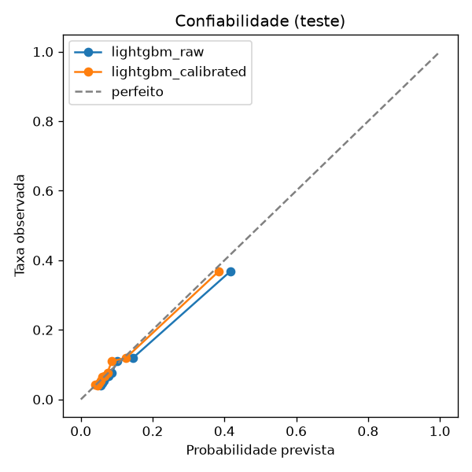
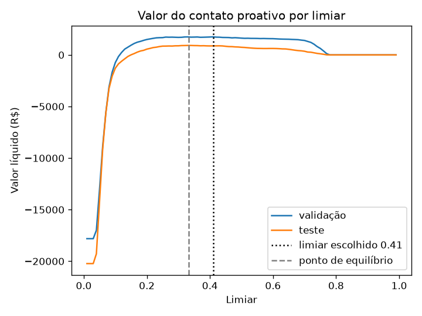
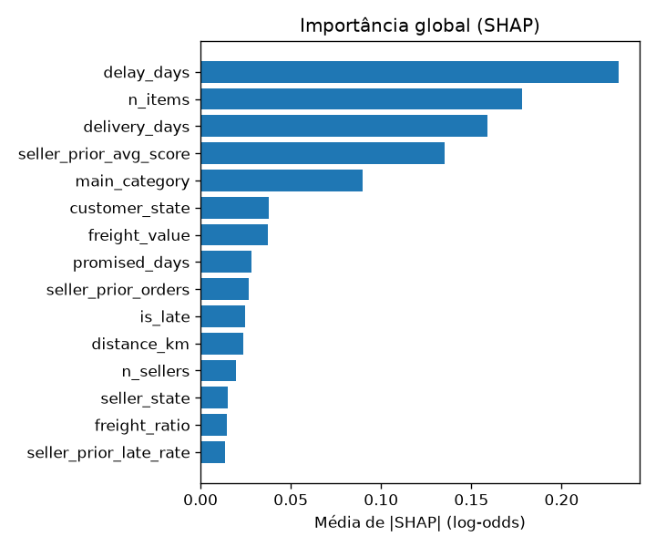

# Modelo de risco: resultados

Gerado por `scripts/train_risk.py`. Não edite à mão: rode o script de novo.

## Divisão temporal

| Parte | Pedidos | Período (entrega) | Taxa negativa |
| --- | ---: | --- | ---: |
| train | 67.020 | 2016-10-11 a 2018-04-27 | 13.5% |
| val | 14.184 | 2018-04-27 a 2018-06-29 | 12.4% |
| test | 14.374 | 2018-06-29 a 2018-10-17 | 9.9% |

Pedidos descartados por o rótulo ainda não existir na data de corte: 246.

## Métricas no teste

| Modelo | PR-AUC | ROC-AUC | Brier | ECE |
| --- | ---: | ---: | ---: | ---: |
| baseline | 0.156 | 0.594 | 0.0891 | 0.0307 |
| logistic | 0.290 | 0.712 | 0.0807 | 0.0133 |
| lightgbm | 0.343 | 0.725 | 0.0766 | 0.0154 |
| lightgbm_calibrated | 0.343 | 0.725 | 0.0764 | 0.0068 |

Taxa base no teste (PR-AUC de um modelo aleatório): 0.099.

### Diferenças de PR-AUC (bootstrap pareado, IC 95%)

- lightgbm_vs_baseline_pr_auc: +0.187 (IC +0.167 a +0.208)
- lightgbm_vs_logistic_pr_auc: +0.053 (IC +0.039 a +0.070)

## Calibração

Método escolhido: **platt** (menor Brier na segunda metade da validação: none 0.0882, isotonic 0.0882, platt 0.0880).

## Limiar por custo

Premissas: contato custa R$ 2, evitar uma avaliação negativa vale R$ 30, e o contato evita 20.0% das negativas.

Ponto de equilíbrio teórico: p = 0.333. Limiar escolhido na validação: **0.41**.

Resultado das políticas no teste:

| Política | Contatos | Negativas alcançadas | Precisão | Recall | Valor líquido |
| --- | ---: | ---: | ---: | ---: | ---: |
| modelo_no_limiar | 549 | 329 | 59.9% | 23.2% | R$ 876 |
| contatar_atrasados | 1.017 | 342 | 33.6% | 24.1% | R$ 18 |
| contatar_todos | 14.374 | 1.420 | 9.9% | 100.0% | R$ -20.228 |
| nao_contatar | 0 | 0 | 0.0% | 0.0% | R$ 0 |

### Sensibilidade às premissas (validação)

| Custo contato | Valor da negativa | Efeito | Equilíbrio | Melhor limiar | Contatos | Valor |
| ---: | ---: | ---: | ---: | ---: | ---: | ---: |
| R$ 1 | R$ 15 | 10.0% | 0.67 | 0.70 | 548 | R$ 76 |
| R$ 1 | R$ 15 | 20.0% | 0.33 | 0.41 | 901 | R$ 875 |
| R$ 1 | R$ 15 | 40.0% | 0.17 | 0.17 | 2.101 | R$ 3.335 |
| R$ 1 | R$ 30 | 10.0% | 0.33 | 0.41 | 901 | R$ 875 |
| R$ 1 | R$ 30 | 20.0% | 0.17 | 0.17 | 2.101 | R$ 3.335 |
| R$ 1 | R$ 30 | 40.0% | 0.08 | 0.08 | 5.369 | R$ 9.883 |
| R$ 1 | R$ 60 | 10.0% | 0.17 | 0.17 | 2.101 | R$ 3.335 |
| R$ 1 | R$ 60 | 20.0% | 0.08 | 0.08 | 5.369 | R$ 9.883 |
| R$ 1 | R$ 60 | 40.0% | 0.04 | 0.04 | 13.720 | R$ 28.040 |
| R$ 2 | R$ 15 | 10.0% | 1.33 | 0.99 | 0 | R$ 0 |
| R$ 2 | R$ 15 | 20.0% | 0.67 | 0.70 | 548 | R$ 152 |
| R$ 2 | R$ 15 | 40.0% | 0.33 | 0.41 | 901 | R$ 1.750 |
| R$ 2 | R$ 30 | 10.0% | 0.67 | 0.70 | 548 | R$ 152 |
| R$ 2 | R$ 30 | 20.0% | 0.33 | 0.41 | 901 | R$ 1.750 |
| R$ 2 | R$ 30 | 40.0% | 0.17 | 0.17 | 2.101 | R$ 6.670 |
| R$ 2 | R$ 60 | 10.0% | 0.33 | 0.41 | 901 | R$ 1.750 |
| R$ 2 | R$ 60 | 20.0% | 0.17 | 0.17 | 2.101 | R$ 6.670 |
| R$ 2 | R$ 60 | 40.0% | 0.08 | 0.08 | 5.369 | R$ 19.766 |
| R$ 5 | R$ 15 | 10.0% | 3.33 | 0.99 | 0 | R$ 0 |
| R$ 5 | R$ 15 | 20.0% | 1.67 | 0.99 | 0 | R$ 0 |
| R$ 5 | R$ 15 | 40.0% | 0.83 | 0.99 | 0 | R$ 0 |
| R$ 5 | R$ 30 | 10.0% | 1.67 | 0.99 | 0 | R$ 0 |
| R$ 5 | R$ 30 | 20.0% | 0.83 | 0.99 | 0 | R$ 0 |
| R$ 5 | R$ 30 | 40.0% | 0.42 | 0.41 | 901 | R$ 2.599 |
| R$ 5 | R$ 60 | 10.0% | 0.83 | 0.99 | 0 | R$ 0 |
| R$ 5 | R$ 60 | 20.0% | 0.42 | 0.41 | 901 | R$ 2.599 |
| R$ 5 | R$ 60 | 40.0% | 0.21 | 0.20 | 1.785 | R$ 11.331 |

## Explicabilidade (SHAP)

| Feature | Média de \|SHAP\| |
| --- | ---: |
| dias de atraso (negativo = adiantado) | 0.232 |
| n_items | 0.178 |
| dias até a entrega | 0.159 |
| nota média anterior do vendedor | 0.135 |
| main_category | 0.090 |
| customer_state | 0.038 |
| freight_value | 0.037 |
| prazo prometido (dias) | 0.028 |
| pedidos anteriores do vendedor | 0.027 |
| atrasou | 0.025 |
| distância cliente-vendedor (km) | 0.024 |
| n_sellers | 0.020 |
| seller_state | 0.015 |
| freight_ratio | 0.014 |
| taxa de atraso anterior do vendedor | 0.014 |

### Três pedidos de exemplo (teste)

**Risco alto**: probabilidade 77.7%, avaliação real não negativa.

- dias de atraso (negativo = adiantado) = 15.123: aumenta o risco (+2.68)
- dias até a entrega = 37.463: aumenta o risco (+0.66)
- atrasou = 1.0: aumenta o risco (+0.18)
- customer_state = RJ: aumenta o risco (+0.11)
- nota média anterior do vendedor = 4.344: reduz o risco (-0.07)

**Risco médio**: probabilidade 6.3%, avaliação real não negativa.

- dias até a entrega = 5.913: reduz o risco (-0.18)
- nota média anterior do vendedor = 4.0: aumenta o risco (+0.17)
- dias de atraso (negativo = adiantado) = -6.282: reduz o risco (-0.12)
- n_items = 1.0: reduz o risco (-0.09)
- pedidos anteriores do vendedor = 15.0: reduz o risco (-0.07)

**Risco baixo**: probabilidade 3.3%, avaliação real não negativa.

- main_category = books_general_interest: reduz o risco (-0.30)
- dias de atraso (negativo = adiantado) = -15.3: reduz o risco (-0.21)
- dias até a entrega = 7.774: reduz o risco (-0.16)
- nota média anterior do vendedor = 4.465: reduz o risco (-0.15)
- n_items = 1.0: reduz o risco (-0.12)
